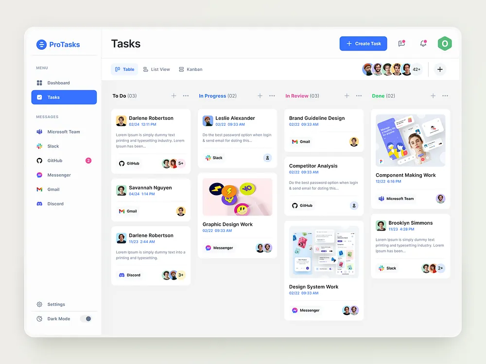

# Blue Kanban Task Board

**Discipline:** web · **Design type:** Dashboard
**Tags:** kanban, tasks, blue, white, cards, avatars, integrations, sidebar

## What it is
A white app window with a sidebar (menu and messaging integrations, dark mode toggle), a Tasks header with table, list and kanban tabs, an avatar stack and a blue Create Task button, and four columns (To Do, In Progress, In Review, Done) of cards with dates, source-app chips and avatar stacks, some with image covers.

## What it means
Colour-coded column titles and source chips make a busy board scannable, and one blue accent keeps it clean.

## Techniques
- Column titles coloured by status
- Source-app chips on each card
- Avatar stacks with a +N count
- Image covers on selected cards
- Active sidebar item as a blue filled pill

## Best for
- Task and project management UI
- Kanban board patterns
- Team collaboration dashboards

## Vocabulary
- **Kanban** — A board with columns showing task status.
- **Source chip** — A small label showing which app a task came from.
- **Avatar stack** — Overlapping avatars with a remainder count.
