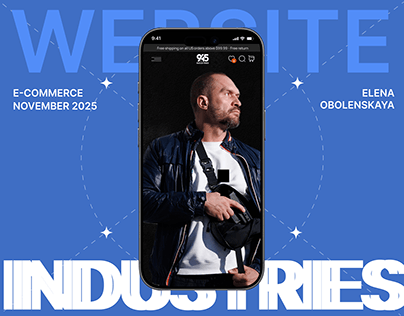

# Royal blue cover with giant 'WEBSITE' and 'INDUSTRIES' words above and below a phone showing a dark portrait shop

**Discipline:** web · **Design type:** Project cover
**Tags:** cover, royal-blue, giant-type, phone, dashed-orbit, sparkles, e-commerce, credits

## What it is
A cobalt background with a huge pale-blue 'WEBSITE' at the top and a white heavy 'INDUSTRIES' at the bottom edge, a centred phone showing a dark store hero with a man holding a helmet, dashed circles with sparkle stars and small left and right captions (E-commerce, November 2025, designer name).

## What it means
Bold and simple; the giant labels sandwich the phone as a clear project cover.

## Techniques
- Sandwich a phone between two giant words.
- Trace dashed circles with sparkle nodes.
- Use one cobalt colour.
- Add small captions at the sides.

## Best for
- E-commerce project covers
- Type-sandwich mockups
- Blue portfolio thumbnails

## Vocabulary
- **Type sandwich** — Giant words above and below an object.
- **Dashed orbit** — Dotted circles around a device.
- **Sparkle node** — A four-point star on a line.
- **Side captions** — Small text in left and right columns.
