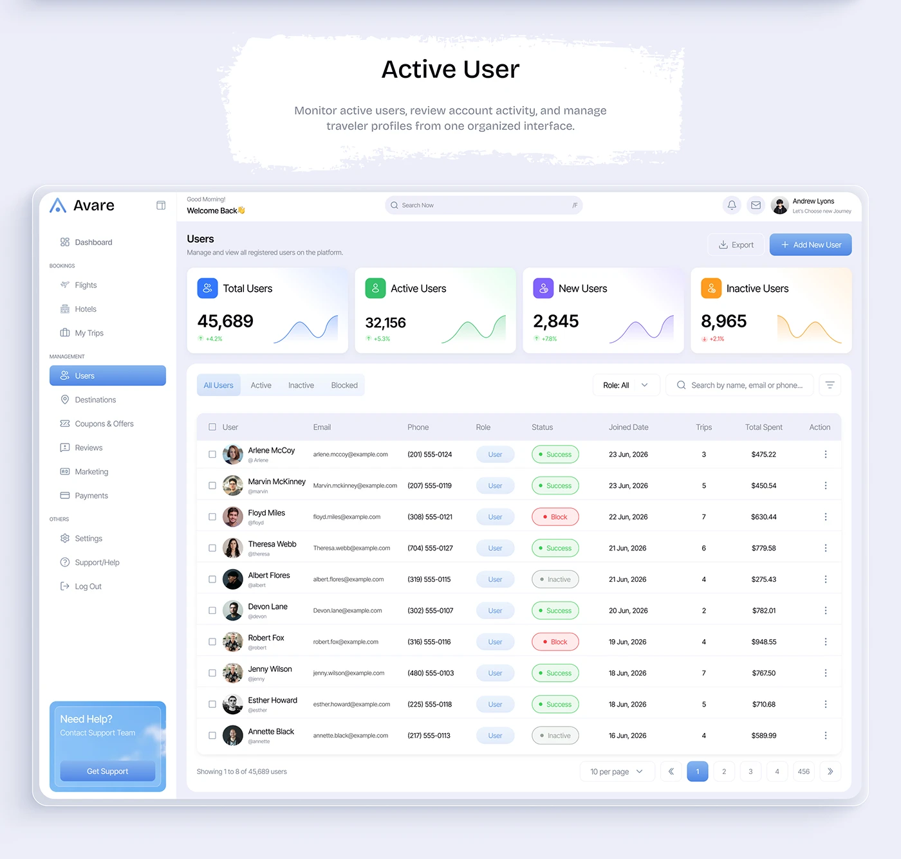

# Travel Admin Active Users Dashboard

**Discipline:** web · **Design type:** Dashboard
**Tags:** dashboard, admin, table, kpi, blue, sidebar, brush-title

## What it is
A lavender board with a torn-paper title 'Active User' above a light admin dashboard: sidebar navigation, four coloured KPI cards with sparklines, filter tabs and a user table with status badges and pagination.

## What it means
Colour-coded KPI cards with tiny sparklines make numbers scannable, and status pills make table states instantly clear.

## Techniques
- Four KPI cards each with its own tint and sparkline
- Status pills in green, red and grey in the table
- Blue gradient primary button and sidebar selection
- Torn-paper title as a friendly annotation
- Avatar and handle in the first table column

## Best for
- Admin panels and back-office UI
- Travel and booking platforms
- Data-table pattern references

## Vocabulary
- **KPI card** — A card showing one key metric with a trend.
- **Sparkline** — A tiny line chart without axes.
- **Status pill** — A coloured rounded label indicating state.
