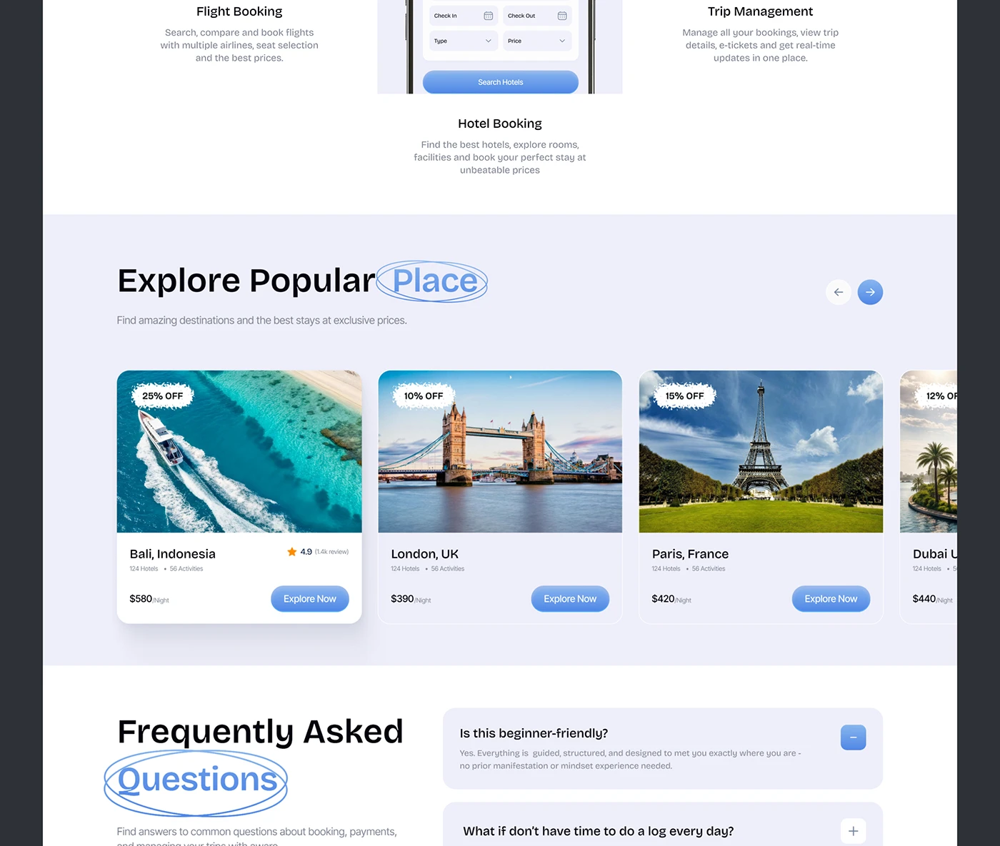

# Travel Landing: Popular Places and FAQ

**Discipline:** web ·  · **Design style:** Playful & Illustrated
**Tags:** travel, landing, cards, faq, circled-word, blue, destinations

## What it is
A cropped landing page: feature columns for flights, hotels and trips, an 'Explore Popular Place' carousel of destination photo cards with scalloped discount tags, and a FAQ accordion with 'Questions' circled in a hand-drawn oval.

## What it means
Lavender panels and blue pills keep a photo-heavy page airy, and the circled word adds a human, handmade touch.

## Techniques
- Hand-drawn oval around one heading word
- Scalloped (torn-edge) discount stickers on photos
- Alternating white and lavender section backgrounds
- Destination cards with price and pill CTA
- Accordion FAQ with blue plus/minus toggles

## Best for
- Travel and booking sites
- Marketing landing pages with destinations
- Sections that need both browsing and reassurance

## Vocabulary
- **Circled word** — A heading word ringed by a sketchy ellipse.
- **Scalloped tag** — A label with wavy or torn edges.
- **Accordion** — A list of items that expand and collapse.
