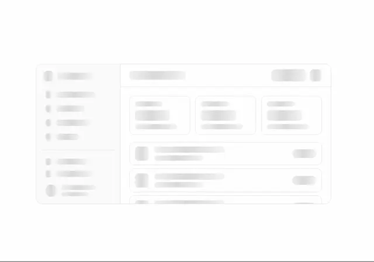

# Ghosted dashboard skeleton: a blurred sidebar, header bar, three stat cards and list rows in pale grey shapes

**Discipline:** web ·  · **Design style:** Glassmorphism
**Tags:** skeleton, dashboard, blur, grey, white, loading, layout, placeholder

## What it is
A white frame containing a very pale, blurred wireframe of an app: a left sidebar with items and a profile, a top bar with title and buttons, three stat cards and several list rows with rounded thumbnails and pills, all as soft grey blocks.

## What it means
Quiet and structural; a blurred skeleton shows layout without content.

## Techniques
- Replace content with pale grey blocks.
- Blur the shapes.
- Keep card and row structure.
- Use as a loading or preview state.

## Best for
- Loading skeletons
- Dashboard preview illustrations
- Wireframe-like graphics

## Vocabulary
- **Skeleton screen** — A placeholder showing layout while content loads.
- **Blurred wireframe** — A softened outline of an interface.
- **Grey block** — A placeholder rectangle for text or image.
- **Stat card placeholder** — A skeleton for a metric card.
