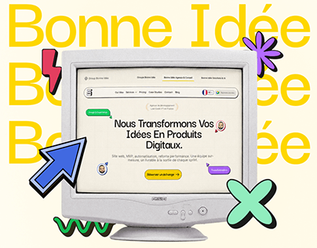

# Bonne Idée agency site inside a beige CRT monitor with giant yellow repeated wordmark and sticker shapes

**Discipline:** web · **Design type:** Project cover · **Design style:** Retro & Pixel
**Tags:** agency, crt, retro, yellow, stickers, french

## What it is
A cream cover with 'Bonne Idée' repeated three times in huge yellow type, an old beige CRT monitor displaying the agency's French homepage ('Nous Transformons Vos Idées En Produits Digitaux'), and chunky sticker shapes around it: a blue cursor arrow, red lightning bolt, purple asterisk, mint X and green squiggle.

## What it means
Nostalgic and cheeky; putting a modern site in an old monitor jokes about digital craft.

## Techniques
- Display a modern site inside retro hardware.
- Repeat the brand name as a giant background pattern.
- Scatter chunky sticker shapes with outlines.

## Best for
- Agency portfolios
- Playful tech brands
- Case study covers

## Vocabulary
- **CRT** — An old bulky cathode-ray tube monitor.
- **Anachronism** — Placing something in the wrong era for effect.
