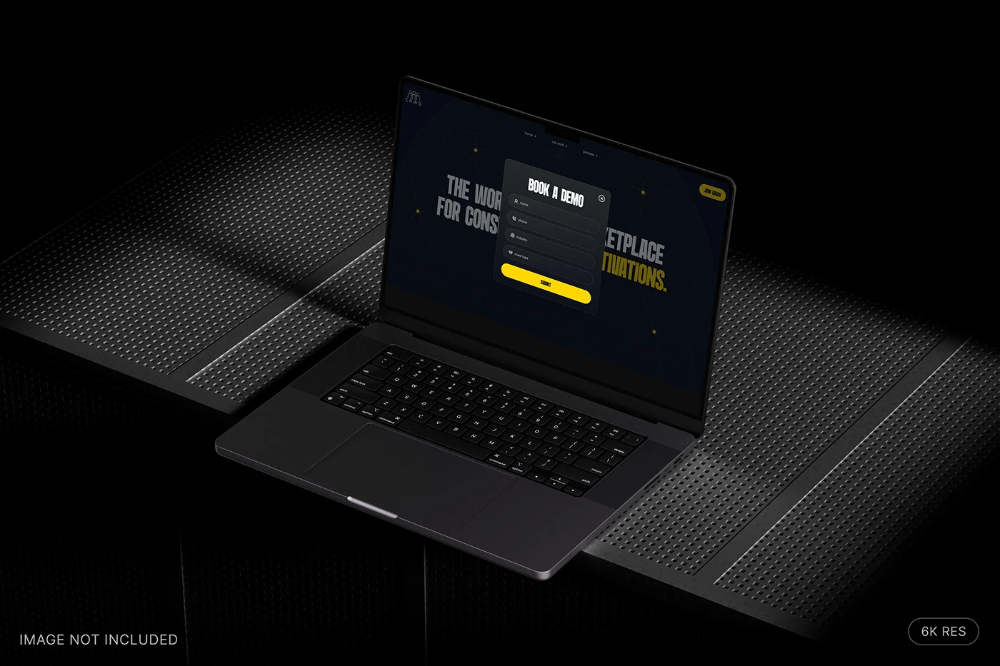

# Dark laptop with a glass 'Book a demo' modal over the yellow condensed hero, on perforated metal sheets

**Discipline:** web · **Design type:** Device mockup scene
**Tags:** laptop-mockup, modal, dark, yellow, perforated-metal, form, isometric, black

## What it is
A black moody scene of an open laptop on perforated steel sheets showing a dark site with giant condensed grey and yellow headline words behind a frosted 'BOOK A DEMO' modal with four dark fields and a yellow Submit pill, with a small '6K RES' tag.

## What it means
Sleek and industrial; the modal is the hero of a low-key mockup.

## Techniques
- Show a modal over the site hero.
- Use a black perforated-metal stage.
- Keep yellow as the only accent.
- Light softly from one side.

## Best for
- Form and modal presentations
- Dark black-and-yellow sites
- Industrial mockup scenes

## Vocabulary
- **Frosted modal** — A translucent dialog over a page.
- **Perforated metal** — Steel sheet with a hole pattern.
- **Form field** — A dark input with an icon.
- **Low-key scene** — A mostly dark, softly lit setup.
