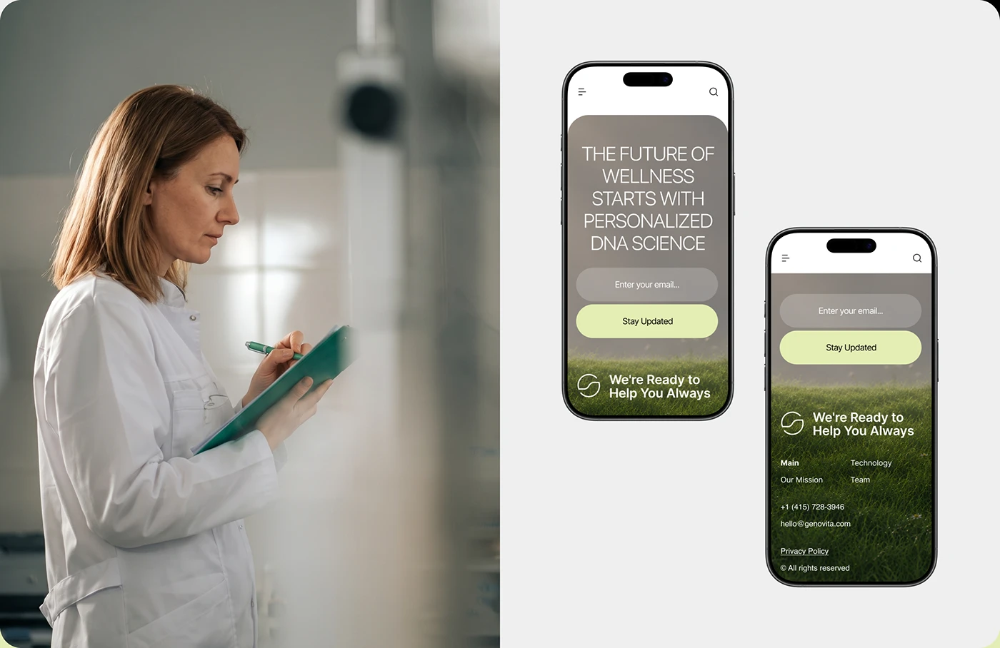

# Scientist photograph beside two phones showing a grass-field hero and footer

**Discipline:** web ·  · **Design style:** Photographic & Cinematic
**Tags:** mobile-web, footer, lime, grass, email-signup, scientist, split-layout, botanical

## What it is
A split image: at left a soft-focus portrait of a researcher writing on a clipboard, at right two phones on pale grey showing a sage overlay hero with an email field and lime button, and a footer over a grass photo with logo, links and contact.

## What it means
Credible and calm; real lab photography grounds the botanical brand.

## Techniques
- Pair a documentary-style portrait with mobile screens.
- Overlay a translucent grey panel on a grass photo for the hero.
- Use a pale lime button for the one action.
- Turn the footer into an image with white text.

## Best for
- Biotech and health brand presentations
- Mobile footer and signup design
- Human-plus-UI collages

## Vocabulary
- **Documentary portrait** — A candid photo of a person at work.
- **Image footer** — A footer built over a photo.
- **Overlay panel** — A translucent panel over an image.
- **Signup field** — An email input with a button.
