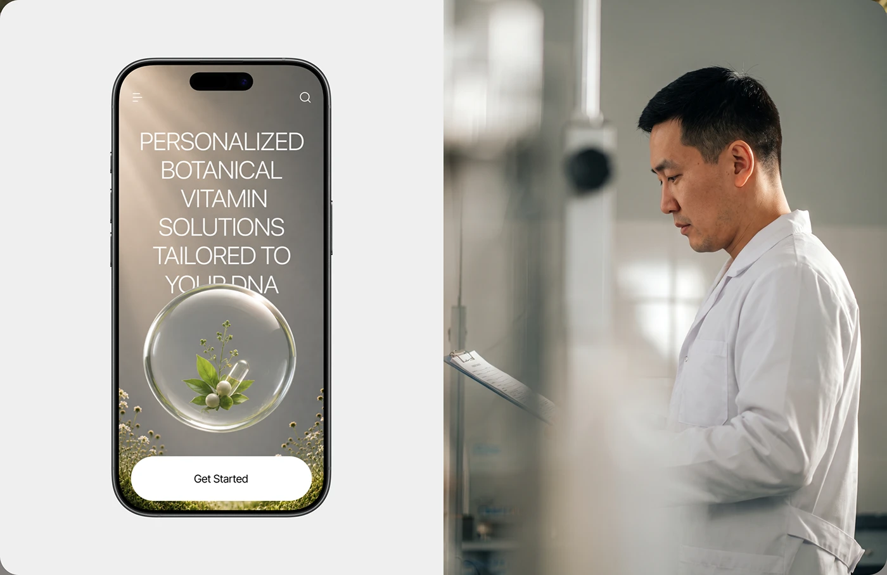

# Phone with thin caps headline and glass sphere plant beside a soft-focus lab technician

**Discipline:** web · **Design type:** Responsive mobile web
**Tags:** mobile-web, hero, glass-sphere, botanical, thin-caps, lab, split, white-button

## What it is
A split image: at left a phone with a hazy sunlit grey-green hero, thin uppercase headline, a glass bubble holding leaves and a capsule and a wide white Get Started button; at right a man in a white coat reading a clipboard in a blurred lab.

## What it means
Scientific yet natural; the bubble unites lab and garden.

## Techniques
- Pair a mobile hero with a documentary lab photo.
- Use a glass orb as a symbolic container.
- Set light uppercase across the whole width.
- Use one large white button.

## Best for
- Personalised health and DNA brands
- Mobile hero showcases
- Human-plus-UI splits

## Vocabulary
- **Symbolic orb** — A sphere containing an object that stands for the product.
- **Light rays** — Beams of light across a backdrop.
- **Split showcase** — UI on one side, photo on the other.
- **Wide CTA** — A full-width button.
