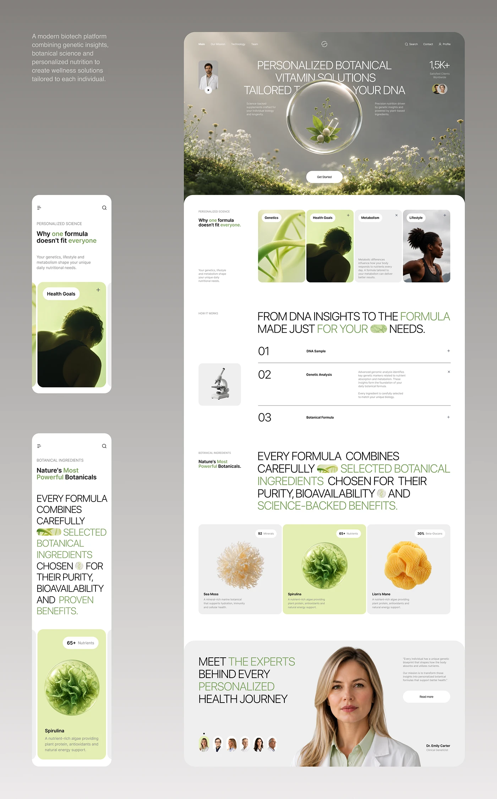

# Botanical biotech site with glass-bubble hero, accordion steps and ingredient cards

**Discipline:** web ·  · **Design style:** Glassmorphism
**Tags:** biotech, botanical, sage-green, glass-sphere, accordion, ingredient-cards, desktop-mobile, statement-type

## What it is
A long grey-green presentation with a desktop page and two mobile screens. The hero is a misty flower meadow with a glass sphere containing a plant, headline in thin caps overlapping it. Below are four cards (genetics, goals, metabolism, lifestyle), a numbered accordion with a microscope, a giant statement with inline icons, three ingredient cards with 3D renders, and an expert section.

## What it means
Serene, scientific and organic; giant light type and inline icons feel like a modern biotech magazine.

## Techniques
- Place a glass sphere holding a plant over a misty landscape as a hero.
- Set headline text behind and around the object for depth.
- Embed small pictograms inside long uppercase statements.
- Present ingredients as pale cards with a photoreal 3D specimen and a stat pill.
- Highlight one card in green among grey ones.

## Best for
- Biotech, nutrition and wellness brands
- Science-meets-nature sites
- Premium supplement landing pages

## Vocabulary
- **Glass sphere** — A transparent orb used as a container for an object.
- **Inline pictogram** — A tiny image embedded within a line of text.
- **Ingredient card** — A card presenting one component with an image and stat.
- **Statement block** — A large paragraph acting as the main graphic.
