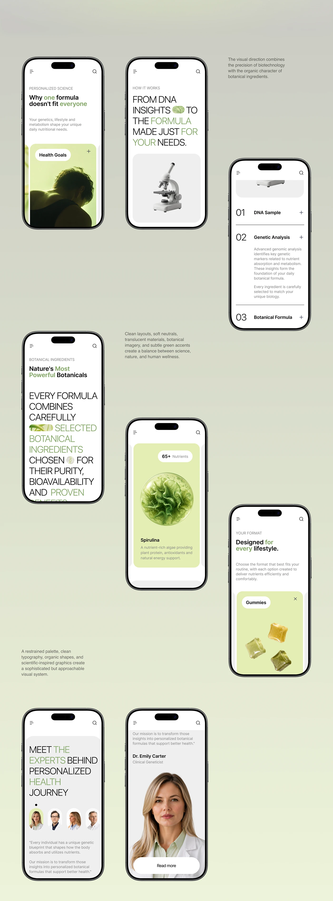

# Nine-screen mobile flow for a botanical DNA wellness site

**Discipline:** web · **Design type:** Responsive mobile web
**Tags:** mobile-web, wellness, sage-green, accordion, product-3d, statement-type, expert, flow

## What it is
A scattered layout of phones over a green gradient with small captions. Screens show a headline and photo, a sentence in giant caps with green highlighted words and a microscope image, an accordion numbered 01 to 03, a botanical ingredient card with a spirulina 3D orb, a gummy format card, a team row and an expert profile with a black pill button.

## What it means
Scientific yet organic; oversized light type and pale green surfaces keep it calm and accessible.

## Techniques
- Mix giant uppercase statements with small captions and cards.
- Use pale green tinted cards with a 3D object at the centre.
- Number process steps in an accordion with thin dividers.
- Stagger phones diagonally with short captions in between.

## Best for
- Health-tech, supplement and DNA-based brands
- Mobile-first content sites
- Case studies of full flows

## Vocabulary
- **Accordion** — A list where each item expands to reveal details.
- **Tinted card** — A card coloured lightly with the brand hue.
- **Scattered layout** — Screens placed at varied heights across the board.
- **3D ingredient render** — A rendered natural object as a hero image.
