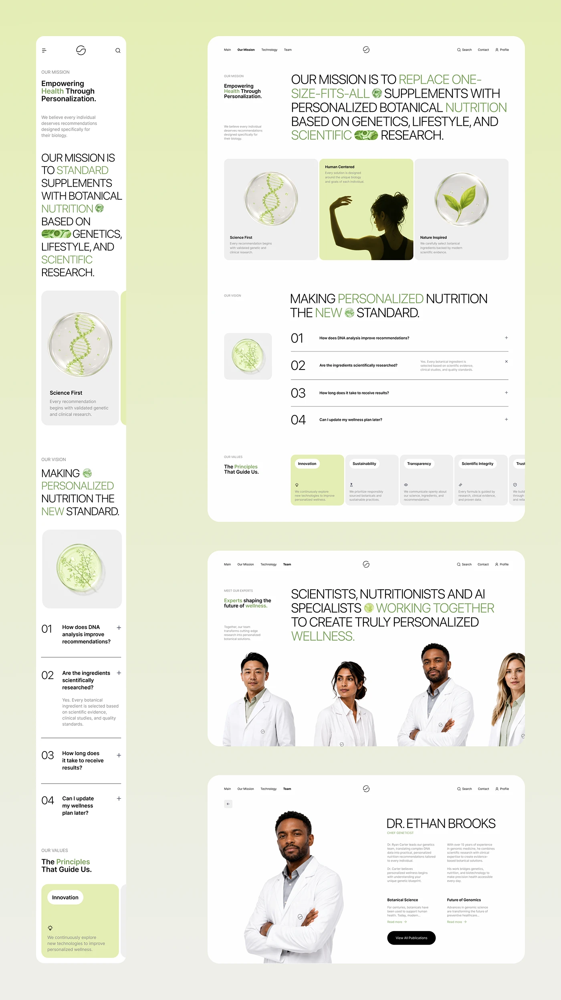

# Mission, FAQ and team pages of a botanical DNA site on a lime gradient

**Discipline:** web ·  · **Design style:** Glassmorphism
**Tags:** mission, faq, team, lime, sage-green, cards, glass-sphere, expert-profile

## What it is
A pale lime board with a mobile column and three desktop pages. Pages have uppercase statement paragraphs with green words and inline icons, three cards with glass-sphere renders and a silhouette photo, a numbered FAQ accordion, value cards with a highlighted lime one, a row of cut-out scientists in white coats and a single expert profile.

## What it means
Warm and credible; scientists on white with green highlights feel clean and human.

## Techniques
- Show team members as cut-out portraits in lab coats standing along the bottom edge.
- Highlight one of a row of cards in lime.
- Combine giant statements with a small side label.
- Use glass-sphere botanicals as consistent illustration.

## Best for
- Mission, FAQ and team sections
- Health and biotech brands
- Pages needing authority without coldness

## Vocabulary
- **Cut-out team row** — Portraits without backgrounds arranged in a line.
- **Highlight card** — The one card in a row given the accent tint.
- **Side label** — A small block of text beside a large statement.
- **FAQ accordion** — Expandable numbered questions.
