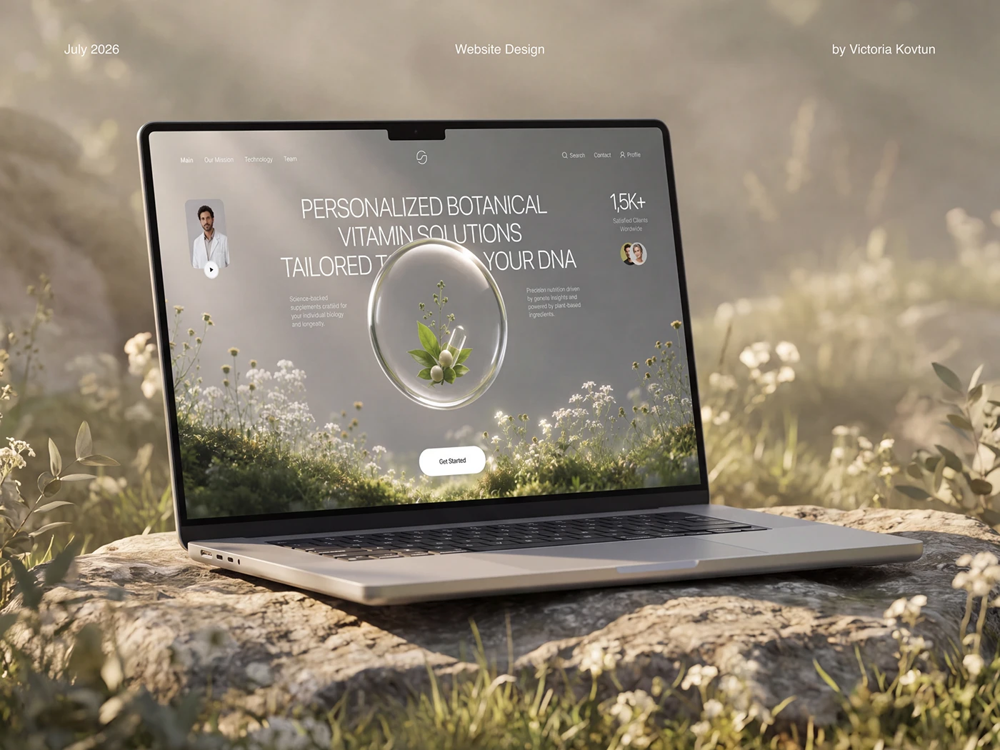

# Botanical biotech site on a laptop resting on a mossy rock in misty light

**Discipline:** web · **Design type:** Device mockup scene
**Tags:** mockup, laptop, nature, mist, botanical, glass-sphere, project-cover, golden-light

## What it is
A laptop sits on a lichen-covered rock among wildflowers in hazy golden light. Its screen mirrors the scene with a misty meadow hero and a glass sphere holding a plant. Tiny captions in the top corners give date, discipline and author.

## What it means
Serene, premium and organic; the screen and setting share one landscape so the site feels inseparable from nature.

## Techniques
- Stage the device inside the same environment its hero image depicts.
- Use shallow depth of field and backlight for a dreamy glow.
- Keep credits as tiny centred text at the top.
- Match screen colours to the surrounding palette.

## Best for
- Wellness and biotech site presentations
- Nature-led brand launches
- Case-study covers wanting atmosphere

## Vocabulary
- **Scene echo** — A mockup setting that repeats the imagery on the screen.
- **Backlight haze** — Soft light from behind that creates a glowing mist.
- **Environmental mockup** — A device placed in a real or rendered setting.
- **Credit line** — Tiny text naming date, type and author.
