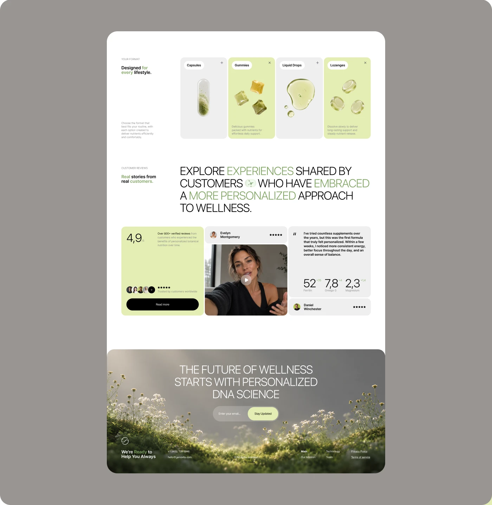

# Supplement page sections: four format cards, giant caps testimonial heading and a meadow footer

**Discipline:** web ·  · **Design style:** 3D & Surreal
**Tags:** supplements, sage-green, format-cards, testimonials, uppercase-headline, meadow-footer, 3d-render, rounded

## What it is
A white rounded page on grey with sections for product formats (capsules, gummies, liquid drops, lozenges as tall tiles alternating grey and pale lime with 3D renders), a giant uppercase heading with green highlighted words, a review row (rating card, video testimonial, quote with stats), and a footer over a misty meadow with an email signup.

## What it means
Clean, fresh and natural; lime tiles and uppercase light type feel modern-wellness.

## Techniques
- Alternate grey and pale lime tall tiles for choices.
- Highlight alternate words of a giant uppercase heading in green.
- Mix rating, video and quote cards in one row.
- End with a photo footer and single email field.

## Best for
- Supplement and wellness landing pages
- Product-format pickers
- Testimonial sections

## Vocabulary
- **Format tile** — A tall card showing one product form.
- **Word highlight** — Alternating words coloured in a heading.
- **Review mosaic** — Rating, video and quote cards together.
- **Image footer** — A footer built on a photograph.
