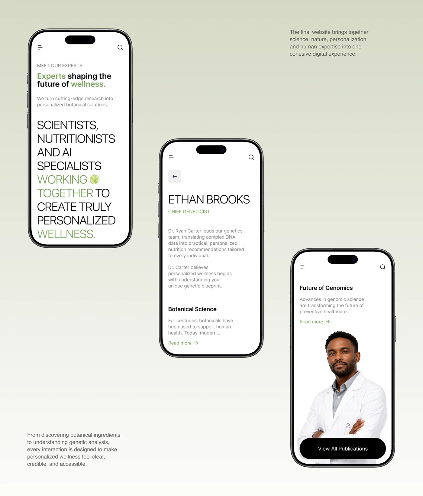

# Botanical wellness site on mobile, sage gradient and giant caps

**Discipline:** web ·  · **Design style:** Warm & Organic
**Tags:** mobile-web, wellness, sage-green, light-weight-type, uppercase, expert-profile, minimal, responsive

## What it is
Three phones over a pale sage gradient. The screens are white with a tiny nav, huge light uppercase sentences with green highlighted words, an expert profile with a doctor photo, and a black pill CTA.

## What it means
Clinical yet natural; oversized light type gives authority while green keeps it botanical.

## Techniques
- Highlight key words in a single green inside long uppercase statements.
- Set text large and light so a whole paragraph reads like a poster on a phone.
- Keep screens white with almost no chrome so the copy is the design.
- Use a large cutout portrait with a black pill button for a strong end-of-page action.

## Best for
- Health-tech, supplements and genetics brands
- Mobile-first editorial sites
- Expert and team pages

## Vocabulary
- **Statement paragraph** — A long sentence set very large as the main graphic.
- **Highlight word** — A word in accent colour inside black text.
- **Light-weight caps** — Uppercase letters in a thin weight.
- **Pill CTA** — A fully rounded button.
