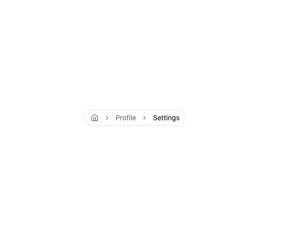

# Rounded breadcrumb pill 'Home > Profile > Settings' with a house icon, grey parents and a black current page

**Discipline:** web · **Design type:** UI components
**Tags:** component, breadcrumb, pill, navigation, white, grey, chevron, minimal

## What it is
A white frame with a thin-bordered capsule containing a house icon, a chevron, a grey 'Profile', another chevron and a black 'Settings'.

## What it means
Understated and clear; contrast alone marks the current page.

## Techniques
- Put the path in a rounded capsule.
- Use a house icon for the root.
- Grey the parents and black the current.
- Separate with chevrons.

## Best for
- Breadcrumb navigation
- Settings pages
- Minimal UI kits

## Vocabulary
- **Breadcrumb** — A trail showing where you are in a hierarchy.
- **Current page** — The last crumb, shown in stronger colour.
- **Root icon** — A house icon standing for Home.
- **Chevron separator** — A small arrow between crumbs.
