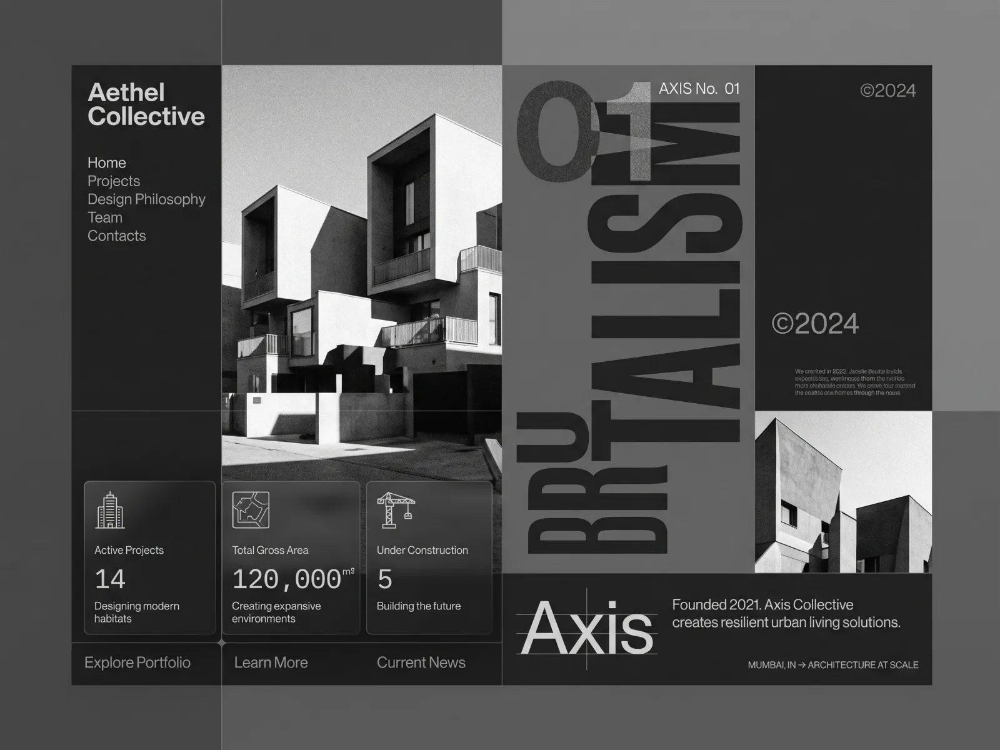

# Greyscale architecture site with a giant vertical 'BRUTALISM', concrete building photos, glass stat cards and boxed layout

**Discipline:** web · **Design type:** Landing page
**Tags:** architecture, greyscale, brutalist, vertical-title, glass-cards, monospace, grid, photography

## What it is
A charcoal-and-grey boxed layout: a left column with the studio name and nav, a tall black-and-white photo of blocky concrete houses, a huge vertical 'BRUTALISM' with '01' in dark type on a mid-grey column, a copyright block with a second photo, three frosted stat cards (14, 120,000, 5) with line icons in monospace, bottom links and a large 'Axis' with a ruler and tagline.

## What it means
Stark and architectural; a modular boxed grid and giant rotated type mirror concrete forms.

## Techniques
- Use a giant rotated word as a column.
- Divide the page into boxed panels.
- Use frosted stat cards with monospace numbers.
- Keep everything black, white and grey.

## Best for
- Architecture and design studio sites
- Brutalist greyscale layouts
- Photo-led modular pages

## Vocabulary
- **Boxed grid** — A page divided into visible rectangular panels.
- **Vertical title column** — A rotated giant word filling a column.
- **Frosted stat card** — A translucent card with a figure.
- **Concrete photography** — Black-and-white images of brutalist buildings.
