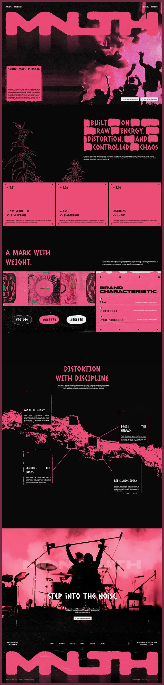

# Underground music label site in hot pink and black with stamp-brush type and halftone crowd

**Discipline:** web · **Design type:** Landing page
**Tags:** music, pink, black, brush-type, halftone, brutalist, long-scroll, distortion

## What it is
A very tall page in black and hot pink: a giant blocky pink brush wordmark over a pink-toned crowd photo, boxed pink cards, brush-lettered headings, a brand characteristics table, colour chips, a torn pink-and-black terrain graphic with four annotated boxes, and a pink-toned drummer photo with 'Step into the noise' and a giant footer wordmark.

## What it means
Raw and loud; rough brush lettering and pink duotone photos feel like a physical zine.

## Techniques
- Set headings in rough stamped letters.
- Tint concert photography hot pink.
- Use registration-mark boxes as cards.
- Draw torn terrain shapes as dividers.

## Best for
- Music labels and festivals
- Underground and punk brands
- Brand-guideline-as-website pages

## Vocabulary
- **Stamp type** — Letters that look rubber-stamped and rough.
- **Duotone photo** — An image in one colour plus black.
- **Registration mark** — Small corner marks used in print as decoration.
- **Torn edge** — A ragged boundary shape.
