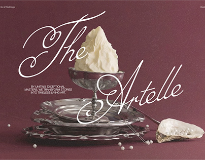

# Burgundy hero with oyster and silver dish photograph under giant flourished script

**Discipline:** web ·  · **Design style:** Editorial
**Tags:** hero, burgundy, script, luxury, catering, still-life, silver, serif-sans

## What it is
A deep burgundy still life with a silver tazza holding a whipped cream peak, silver plates, an oyster shell and scattered pearls. A huge white calligraphic script 'The Artelle' sweeps across it, with a small caps tagline at the left.

## What it means
Opulent and theatrical; script over glossy metal suggests fine dining and heirloom craft.

## Techniques
- Lay a very large script across a still life so it weaves through the objects.
- Use a monochrome burgundy set with silver highlights.
- Keep the tagline small and uppercase.
- Scatter pearls as a detail.

## Best for
- Luxury catering, events and weddings
- Fine-dining and boutique sites
- Still-life led heroes

## Vocabulary
- **Calligraphic script** — Flowing formal handwriting-style lettering.
- **Still-life hero** — A hero image made of arranged objects.
- **Tazza** — A shallow footed dish used for serving.
- **Tonal set** — A scene styled in one colour family.
