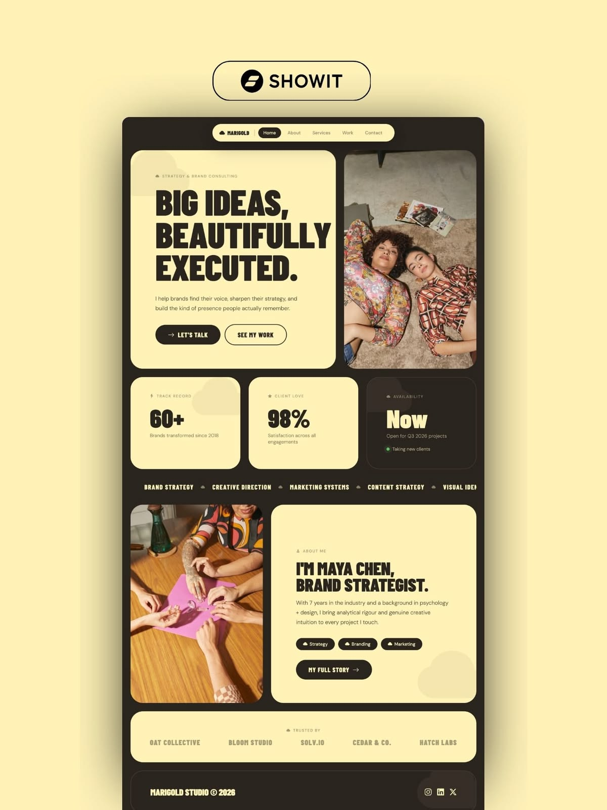

# Butter-yellow rounded bento site inside a charcoal frame with heavy condensed headlines

**Discipline:** web · **Design type:** Portfolio site
**Tags:** portfolio, bento, butter-yellow, charcoal, condensed-type, stat-cards, ticker, consulting

## What it is
A charcoal-framed page with a pill nav and rounded butter-yellow cards: a big card 'BIG IDEAS, BEAUTIFULLY EXECUTED.' with two buttons beside a photo of two women on a rug, stat cards (60+, 98%) and a dark availability card, a services ticker, an about card with a photo and tag chips, a trusted-by row and a dark footer.

## What it means
Warm and confident; yellow cards on charcoal feel bold yet friendly.

## Techniques
- Build a bento of rounded yellow cards.
- Set headings in heavy condensed caps.
- Switch one card to dark for contrast.
- Run a services ticker between rows.

## Best for
- Consultant and freelancer sites
- Bento portfolios
- Yellow and charcoal brands

## Vocabulary
- **Bento card** — A rounded tile in a grid.
- **Services ticker** — A strip of scrolling service names.
- **Availability card** — A tile showing whether taking clients.
- **Charcoal frame** — A dark border around a page.
