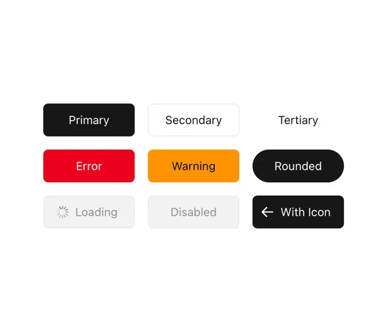

# Button state sheet: primary, secondary, tertiary, error, warning, rounded, loading, disabled and with icon

**Discipline:** web ·  · **Design style:** Dark & Neon
**Tags:** component, buttons, states, black, red, orange, grey, ui-kit

## What it is
A white board with a 3x3 grid of buttons: a black Primary, an outlined Secondary, a text Tertiary, a red Error, an orange Warning, a black pill Rounded, a grey Loading with a spinner, a grey Disabled and a black With Icon with a left arrow.

## What it means
Systematic and readable; each state is named and visually distinct.

## Techniques
- Show every button state in one grid.
- Use semantic colours for error and warning.
- Use spinner and grey for loading and disabled.
- Keep labels centred.

## Best for
- Design system button documentation
- UI kit overviews
- State coverage sheets

## Vocabulary
- **Button state** — A variant such as primary, error or disabled.
- **Semantic colour** — A colour that signals meaning (red for error).
- **Loading spinner** — An icon showing progress inside a button.
- **Pill button** — A fully rounded button.
