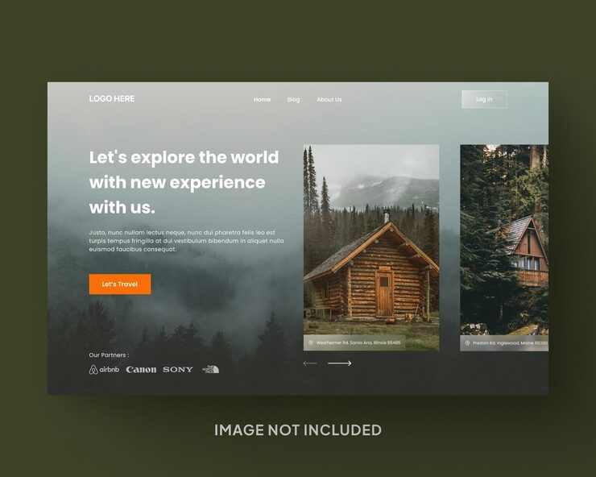

# Travel hero on a misty forest with 'Let's explore the world' and a cabin photo card slider

**Discipline:** web · **Design type:** Landing page hero · **Design style:** Photographic & Cinematic
**Tags:** travel, hero, forest, slider, orange, partners

## What it is
A full-bleed misty pine forest hero with white nav, a bold 'Let's explore the world with new experience with us.' headline, an orange 'Let's Travel' button, partner logos (Airbnb, Canon, Sony), and a horizontal slider of tall cabin photo cards with address tags and arrow controls.

## What it means
Atmospheric and adventurous; the misty backdrop sets mood while cards invite browsing.

## Techniques
- Use a moody full-bleed landscape behind text.
- Add a card slider cropped at the edge to invite scrolling.
- Show partner logos as social proof.
- Use one warm CTA against cool tones.

## Best for
- Travel agencies
- Cabin rentals
- Outdoor brands

## Vocabulary
- **Card slider** — A horizontal row of cards scrolled with arrows.
- **Social proof** — Logos or quotes that build trust.
