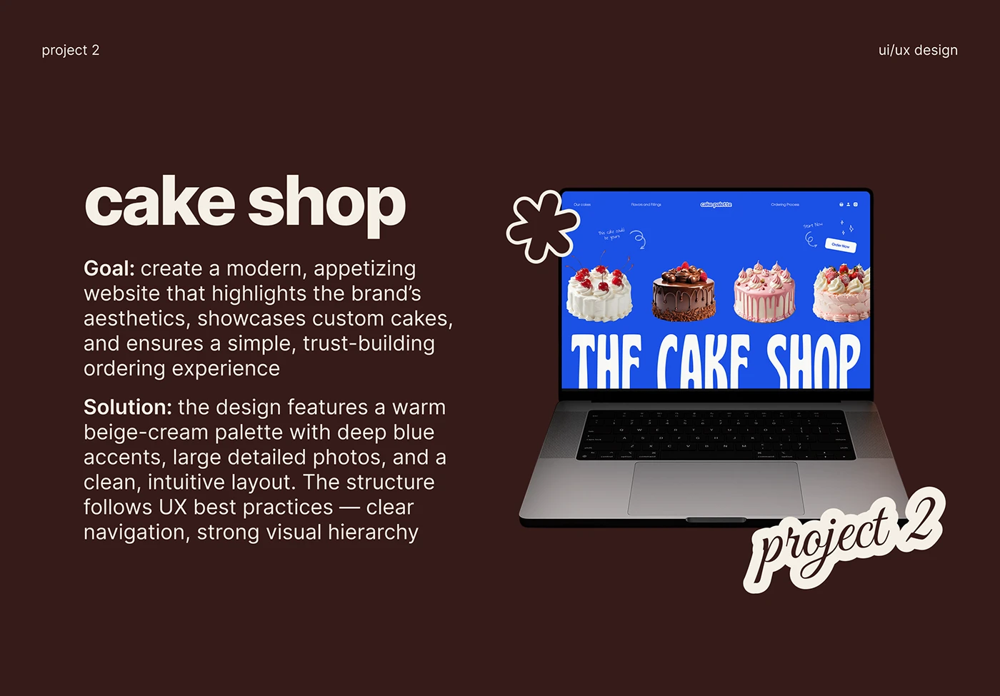

# Cake shop UI/UX slide with goal and solution text beside a laptop and outline flower sticker

**Discipline:** web ·  · **Design style:** Playful & Illustrated
**Tags:** case-study, chocolate-brown, cream, laptop, sticker, script, bold-lead-in, cobalt-screen

## What it is
A deep chocolate slide with small header labels, a large cream 'cake shop' title, two paragraphs with bold Goal and Solution lead-ins, a laptop showing the cobalt cake site, a cream-outlined flower sticker and a script 'project 2' outline sticker.

## What it means
Warm and confident; the dark brown frame makes the cobalt screen glow.

## Techniques
- Use cream on chocolate for all text.
- Add outline stickers overlapping the device corners.
- Lead each paragraph with a bold label.
- Let the bright screen be the only saturated element.

## Best for
- Web design case-study slides
- Food and bakery projects
- Portfolio decks with a consistent template

## Vocabulary
- **Goal / Solution** — A two-paragraph structure describing intent and answer.
- **Outline sticker** — A shape or script with a thick contrasting border.
- **Dark frame** — A dark slide that makes a bright screen pop.
- **Template consistency** — Repeating a slide layout across projects.
