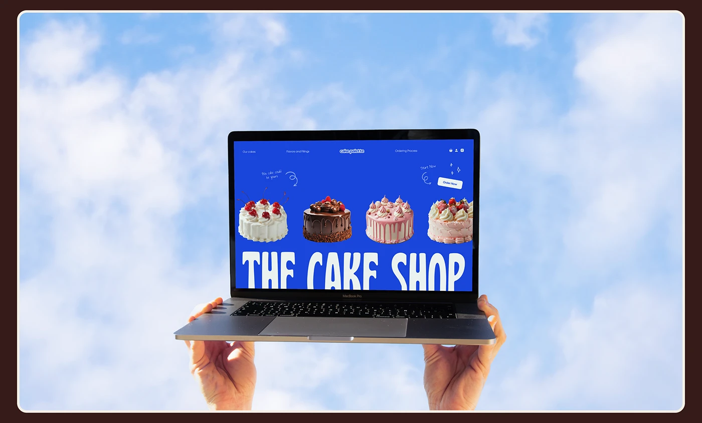

# Cobalt cake-shop site on a laptop held aloft against a cloudy sky

**Discipline:** web · **Design type:** Device mockup scene
**Tags:** mockup, laptop, sky, cobalt, hands, cake, bubble-type, cream-frame

## What it is
A rounded brown-outlined image of a bright sky with two hands holding up an open laptop. The screen shows a cobalt page with four cake cutouts in a row, hand-drawn notes and a huge cream 'THE CAKE SHOP' in tall wavy letters cropped at the bottom.

## What it means
Playful and celebratory; holding the laptop up like a tray offers the site like a cake.

## Techniques
- Hold the device aloft like a serving tray.
- Use a sky backdrop matching the cobalt.
- Show a row of product cutouts above a cropped giant title.
- Add handwritten notes with arrows.

## Best for
- Food and bakery web presentations
- Playful e-commerce
- Product-as-offering metaphors

## Vocabulary
- **Tray pose** — Hands presenting a device like a tray.
- **Cropped title** — A giant word cut by the screen edge.
- **Sky backdrop** — A cloudy sky used as background.
- **Handwritten note** — A script annotation with arrow.
