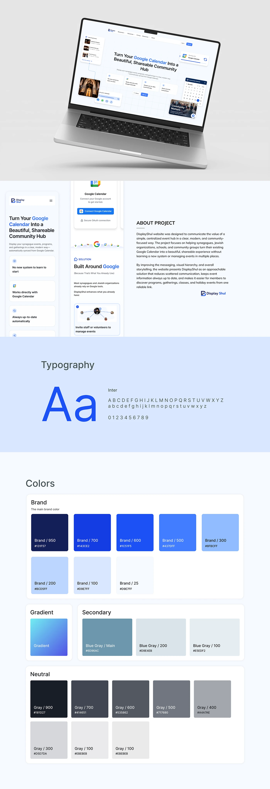

# Case study sheet: floating laptop, mobile screens, Inter specimen and blue ramp with neutrals

**Discipline:** web · **Design type:** Design system documentation
**Tags:** case-study, design-system, blue, typography, colour-ramp, laptop-mockup, hex-codes, light

## What it is
A tall pale sheet with a floating laptop showing a calendar-sharing site, mobile screens beside an About Project text, a large blue 'Aa' Inter specimen and a Colors section with a blue brand ramp, a cyan gradient chip, blue-grey secondary and a grey neutral ramp, each labelled with hex codes.

## What it means
Organised and clear; a full ramp per hue shows system thinking.

## Techniques
- Show the brand as a numbered ramp from 950 to 25.
- Separate brand, gradient, secondary and neutral groups.
- Use a giant Aa for type.
- Open with a floating laptop hero.

## Best for
- Design system documentation
- Web case study wrap-ups
- Blue SaaS brands

## Vocabulary
- **Colour ramp** — Numbered tints from dark to light.
- **Neutral scale** — A grey ramp for text and surfaces.
- **Type specimen** — A display of a typeface with alphabets.
- **Floating laptop** — A laptop suspended without a surface.
