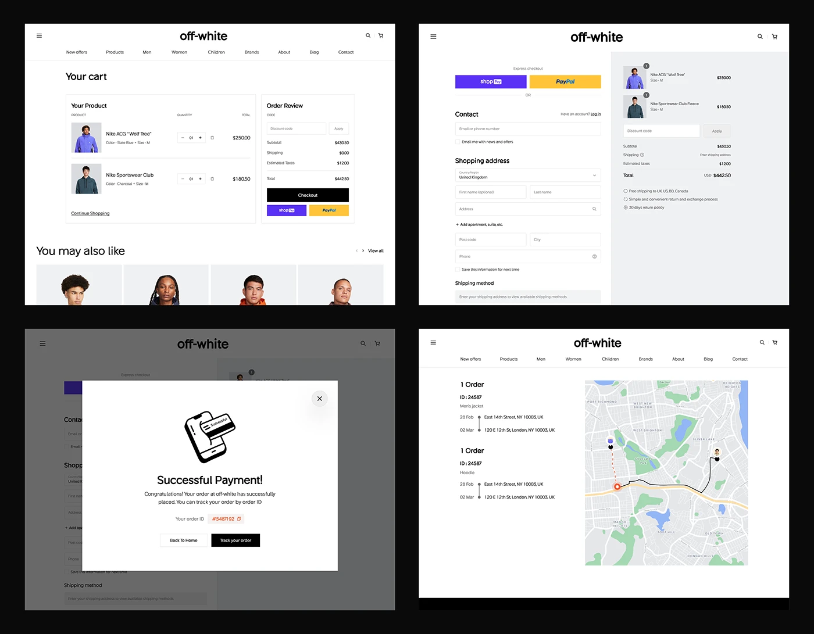

# Four fashion-store flow screens on black: cart, checkout, payment success modal and order-tracking map

**Discipline:** web ·  · **Design style:** Dark & Neon
**Tags:** checkout, cart, modal, tracking, map, black-and-white, purple, yellow

## What it is
A black board with four white desktop screens: cart with product rows and order review with a black Checkout and purple and yellow express buttons; a two-column checkout form with a grey summary; a dimmed page with a payment success modal and outline illustration; and an orders tracking page with a map route.

## What it means
Clear and calm; monochrome UI with just purple and yellow express buttons.

## Techniques
- Keep the UI black and white.
- Use brand-coloured express buttons only.
- Show a modal with a line illustration.
- Pair order timeline with a map.

## Best for
- E-commerce flow design
- Checkout and confirmation states
- Monochrome commerce

## Vocabulary
- **Express checkout** — Fast pay buttons above a form.
- **Success modal** — A dialog confirming an action.
- **Order timeline** — A list of steps with dates and addresses.
- **Route map** — A map showing a delivery path.
