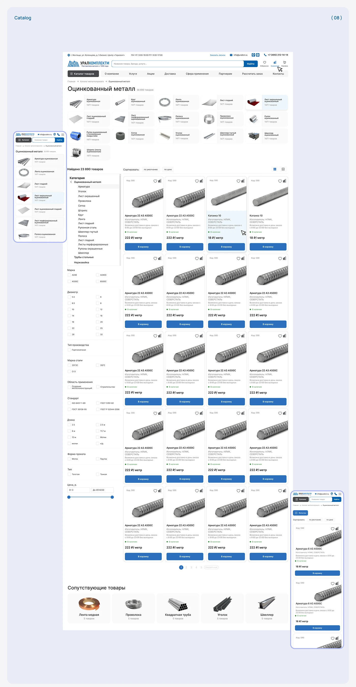

# Long catalog listing: category tiles, sidebar filters, four-up product cards and related products, with mobile views

**Discipline:** web · **Design type:** E-commerce storefront
**Tags:** catalog, listing, filters, blue, product-grid, pagination, mobile, cyrillic

## What it is
A lavender board '(08) Catalog' with a tall desktop page: header with search and nav, a title with count, a grid of category tiles with photos, a left sidebar of category tree and checkbox filters, a four-column grid of product cards with price and blue cart buttons, pagination and related products; two mobile lists sit at the sides.

## What it means
Thorough and practical; repeated cards and clear filters make thousands of items manageable.

## Techniques
- Use category image tiles above the grid.
- Keep a persistent filter sidebar.
- Repeat product cards with consistent info.
- Show mobile as single-column list.

## Best for
- Large B2B catalogues
- Listing page design
- Filter-heavy commerce

## Vocabulary
- **Category tile** — A small image card linking to a subcategory.
- **Filter sidebar** — A left column of filters.
- **Product card** — A card with photo, name, price and button.
- **Pagination** — Numbered navigation across result pages.
