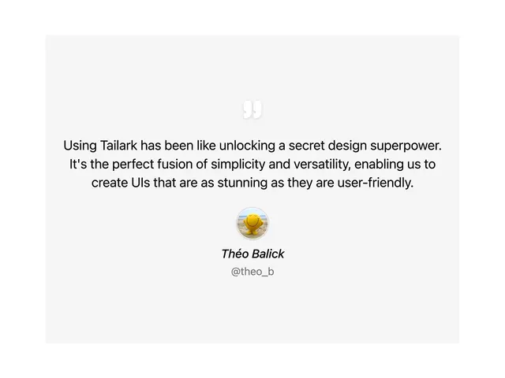

# Centred testimonial on a pale grey block: a large quotation mark, a centred quote, a round avatar with an italic name and a grey handle

**Discipline:** web ·  · **Design style:** Editorial
**Tags:** component, testimonial, quote, grey, centred, avatar, italic, minimal

## What it is
A light grey rectangle on white with a small dark quotation mark at the top centre, a three-line centred black quote about a design superpower, a round photo avatar, an italic name 'Théo Balick' and a lighter grey handle '@theo_b'.

## What it means
Quiet and readable; a single centred quote gives one voice full attention.

## Techniques
- Centre the quote and attribution.
- Use a large quote mark as a visual cue.
- Set the name in italic and the handle in grey.
- Keep a plain grey block.

## Best for
- Single testimonial sections
- Minimal quote components
- Neutral marketing pages

## Vocabulary
- **Quote mark** — A large opening quotation glyph.
- **Centred attribution** — Avatar, name and handle centred below a quote.
- **Grey block** — A pale grey container.
- **Handle** — A social username in grey.
