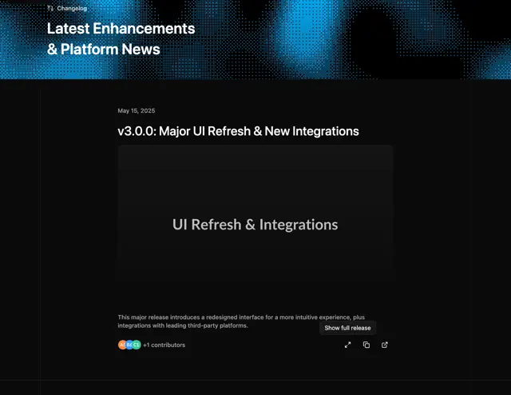

# Dark changelog with a cyan halftone-dot banner, a dated release title, a placeholder feature card and contributor avatars with action icons

**Discipline:** web ·  · **Design style:** Retro & Pixel
**Tags:** changelog, dark, halftone, cyan, release-notes, avatars, minimal, banner

## What it is
A black page whose top banner is a cyan and black dithered dot pattern with 'Changelog' and 'Latest Enhancements & Platform News', below a narrow column with a date, a release title 'v3.0.0: Major UI Refresh & New Integrations', a large dark card reading 'UI Refresh & Integrations', a short description, avatar chips '+1 contributors' and three icon buttons with a 'Show full release' tooltip.

## What it means
Technical and tidy; a dot banner brings texture to an otherwise text-driven page.

## Techniques
- Use a dithered dot banner as a header.
- Keep a narrow reading column.
- Show contributors as avatar chips.
- Add small action icons with tooltips.

## Best for
- Changelog and release-note pages
- Dark developer sites
- Halftone headers

## Vocabulary
- **Dither banner** — A header made of dithered dots.
- **Release entry** — A dated block describing a version.
- **Contributor chips** — Small avatars showing who contributed.
- **Tooltip label** — A small label describing an icon button.
