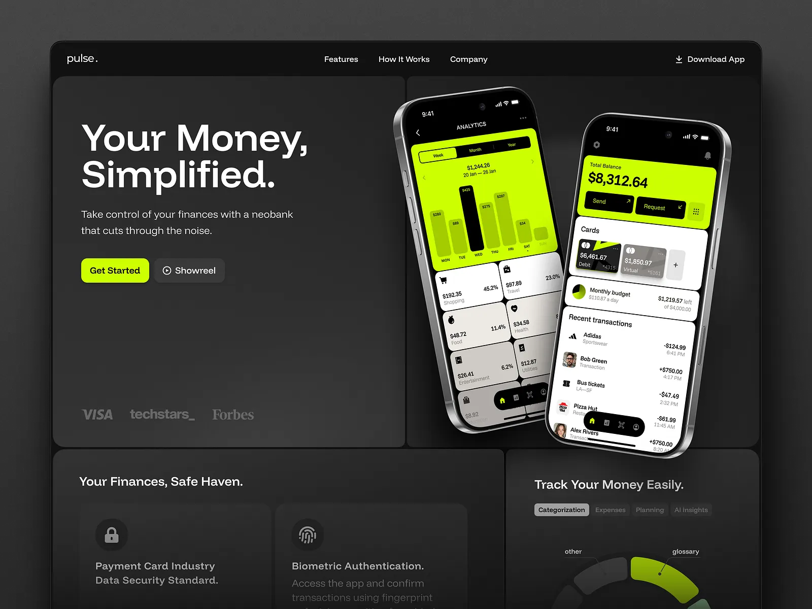

# Charcoal neobank site with a huge white 'Your Money, Simplified.', a lime-and-black analytics phone pair and dark tiled feature panels

**Discipline:** web · **Design type:** SaaS landing page
**Tags:** fintech, charcoal, lime, phones, tilted, tiles, dark-ui, bento

## What it is
A charcoal browser frame with a nav and a Download App link, a big tile with a headline, subline, lime Get Started and grey Showreel buttons and faded logos, beside a tile with two tilted silver phones showing a lime analytics chart and a white transactions list, and below two dark tiles: 'Your Finances, Safe Haven.' with security cards and 'Track Your Money Easily.' with tabs and a lime donut segment.

## What it means
Bold and high-contrast; lime on charcoal makes a neobank feel sharp and modern.

## Techniques
- Split the page into dark rounded tiles.
- Use lime as the only accent in phone UIs.
- Tilt phones at opposite angles.
- Fade logos to low contrast.

## Best for
- Neobank and fintech sites
- Charcoal and lime brands
- Tiled bento pages

## Vocabulary
- **Dark tile** — A rounded charcoal panel in a grid.
- **Lime accent** — A neon green used for actions and charts.
- **Showreel button** — A secondary button with a play icon.
- **Faded logo row** — Partner logos at very low contrast.
