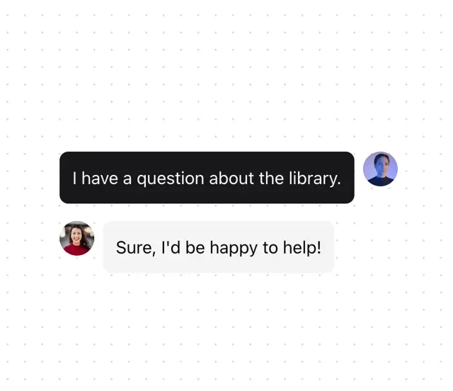

# Chat component with a black outgoing bubble and a grey incoming bubble, each with a round avatar, on a dotted ground

**Discipline:** web ·  · **Design style:** Dark & Neon
**Tags:** component, chat, bubbles, black, grey, avatars, dotted, ui-kit

## What it is
A dotted white frame with two chat bubbles: a black bubble 'I have a question about the library.' with a photo avatar at the right and a light grey reply 'Sure, I'd be happy to help!' with an avatar at the left.

## What it means
Simple and clear; black versus grey shows who is speaking.

## Techniques
- Use black for the user and grey for the reply.
- Place avatars outside the bubbles.
- Round every bubble.
- Keep a dotted background.

## Best for
- Chat and support components
- Minimal UI kits
- Two-tone conversation UIs

## Vocabulary
- **Outgoing bubble** — A message from the user, often dark.
- **Incoming bubble** — A reply, often light grey.
- **Avatar** — A small round profile image.
- **Dotted ground** — A faint dot grid as background.
