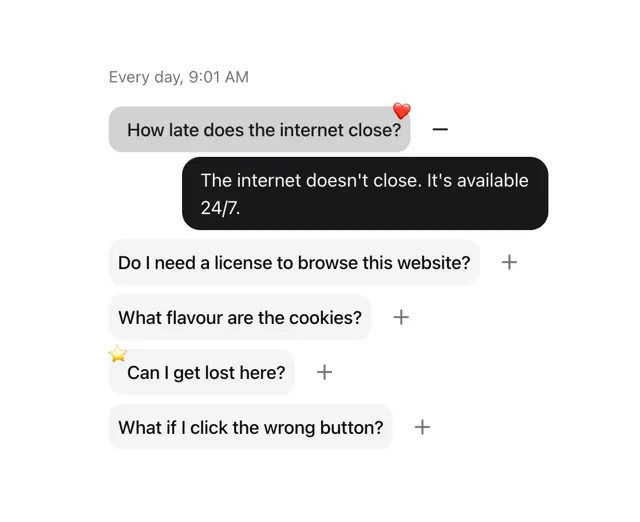

# FAQ shown as iMessage-like bubbles: grey questions with plus icons, an open one with a black answer bubble, and emoji reactions

**Discipline:** web ·  · **Design style:** Playful & Illustrated
**Tags:** component, faq, chat, bubbles, black, grey, emoji, playful

## What it is
A white frame with a small timestamp 'Every day, 9:01 AM' and a list of light grey question bubbles with plus icons; the open one is darker grey with a minus and a red heart reaction and is answered by a black right-aligned bubble 'The internet doesn't close. It's available 24/7.', while another has a star reaction.

## What it means
Playful and human; framing an FAQ as a conversation makes it feel friendly.

## Techniques
- Style questions as chat bubbles.
- Answer in a black bubble on the other side.
- Add emoji reactions to corners.
- Use plus and minus to toggle.

## Best for
- Conversational FAQ sections
- Friendly support pages
- Chat-styled components

## Vocabulary
- **Chat FAQ** — An FAQ presented as a message thread.
- **Reaction sticker** — An emoji attached to a bubble corner.
- **Answer bubble** — A dark bubble carrying the reply.
- **Timestamp header** — A small time label above a thread.
