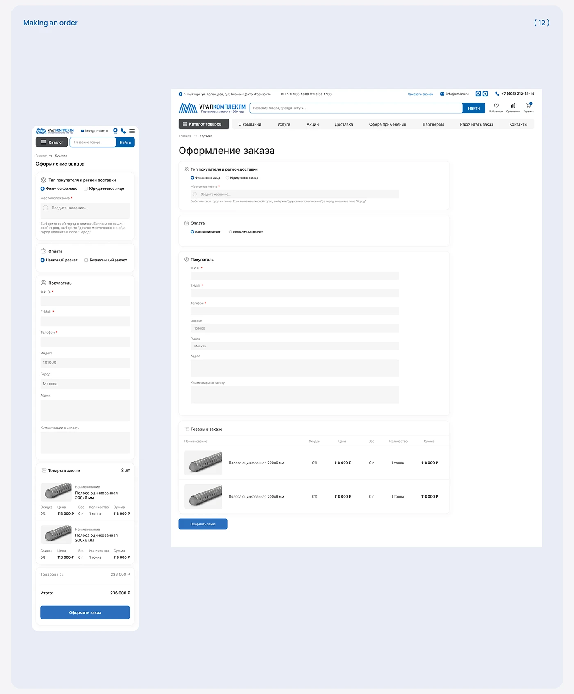

# Order checkout page in blue and grey, desktop and mobile

**Discipline:** web · **Design type:** Checkout and forms
**Tags:** checkout, form, cart, blue, cyrillic, ecommerce, ui-kit, responsive

## What it is
A lilac-blue board with numbered header 'Making an order' and two views of a B2B checkout: sections for buyer type and region, payment, buyer details and an order table with item thumbnails, followed by a blue submit button.

## What it means
Orderly and calm; grouped white cards with light grey fields make a long form feel manageable.

## Techniques
- Split a long form into titled white cards with small icons.
- Use light grey filled inputs with tiny labels and a single blue action.
- Lay the order table beneath the form with thumbnails, price and quantity columns.
- Reuse the same card structure at mobile width.

## Best for
- Checkout and quote-request flows
- B2B commerce
- Design-system form patterns

## Vocabulary
- **Form section card** — A grouped set of related fields in one container.
- **Filled input** — A field with a soft grey background rather than outline.
- **Order table** — A list of line items with price and quantity.
- **Radio group** — Choice among a few options.
