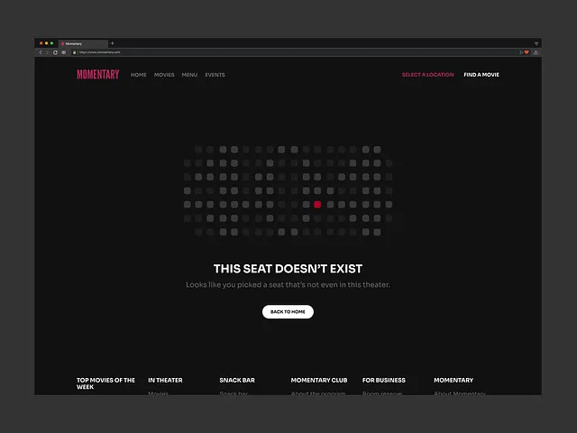

# Dark cinema site 404 as a grid of seats with one glowing red seat and 'This seat doesn't exist'

**Discipline:** web · **Design type:** Page section
**Tags:** 404, error-page, dark, red, seat-map, metaphor, browser-mockup, white-button

## What it is
A dark browser window with a red condensed logo and nav, a large grid of rounded grey seat squares with one lit red seat, a white bold message 'THIS SEAT DOESN'T EXIST' and a grey subtitle, a white Back to Home pill and a footer link grid.

## What it means
Witty and on-theme; the missing seat turns an error into a cinema joke.

## Techniques
- Use the product's own metaphor (seat map) for the error.
- Highlight one item in red.
- Keep the rest greyscale.
- Provide a single white exit button.

## Best for
- Cinema and ticketing 404 pages
- Metaphor-based error states
- Dark minimal error pages

## Vocabulary
- **Seat map** — A grid of seats used as an interface.
- **Metaphor 404** — An error page themed on the brand's product.
- **Single red accent** — One red element in an otherwise grey scene.
- **Back to home pill** — A capsule button returning to the start.
