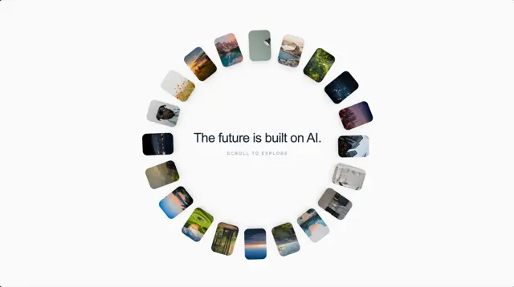

# Ring of small rounded photo cards arranged in a circle around the centred line 'The future is built on AI.' and a scroll cue

**Discipline:** web ·  · **Design style:** Minimalist
**Tags:** hero, gallery, circle, photo-cards, white, minimal, scroll, kinetic

## What it is
A white page with about twenty small tilted rounded photos (mountains, lakes, forest, dusk skies) placed evenly around a large circle, and inside it a centred light headline 'The future is built on AI.' with a tiny 'SCROLL TO EXPLORE' line.

## What it means
Airy and kinetic; a ring of images frames a single line and hints at rotation.

## Techniques
- Place photos evenly on a circle.
- Tilt each tile along the ring.
- Centre one calm headline.
- Add a small scroll cue.

## Best for
- Hero sections with rotating galleries
- Minimal photography sites
- Circular layouts

## Vocabulary
- **Photo ring** — Photos arranged around a circle.
- **Radial tilt** — Each item rotated to follow the circle.
- **Scroll cue** — A small line inviting the user to scroll.
- **Centre statement** — A headline inside a ring of images.
