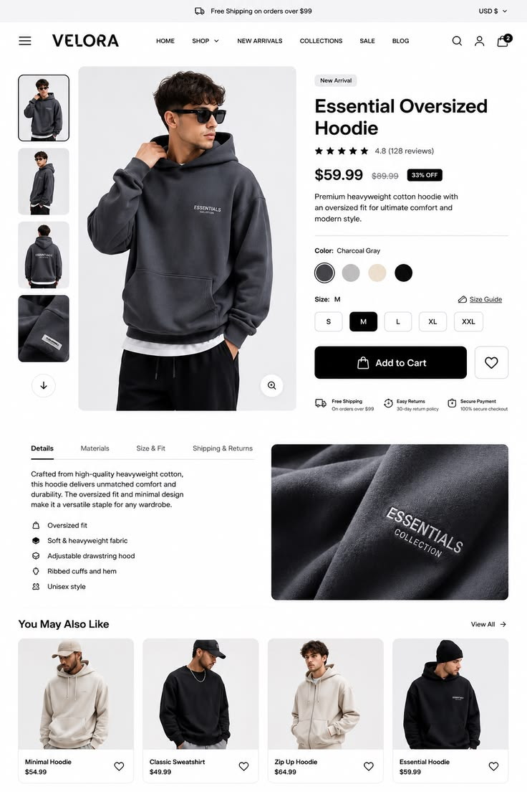

# Minimal hoodie PDP with vertical thumbnails, colour and size selectors, tabs and related grid

**Discipline:** web · **Design type:** Product detail page
**Tags:** pdp, fashion, white, black, swatches, size-pills, tabs, related-products

## What it is
A white page with a top shipping bar, centred logo nav, vertical thumbnail strip with a large model photo, product title, rating, price with discount tag, colour swatches, size pills, a wide black Add to Cart with heart, trust icons, detail tabs with a macro fabric photo and a 'You may also like' row.

## What it means
Clear and trustworthy; consistent controls and neutral styling suit a clothing store.

## Techniques
- Use a vertical thumbnail strip beside a large photo.
- Round swatches and size pills.
- One wide black CTA.
- Show a macro fabric photo for quality.

## Best for
- Fashion e-commerce PDPs
- Minimal storefronts
- Detail page templates

## Vocabulary
- **Thumbnail strip** — A vertical column of small product images.
- **Colour swatch** — A circle showing a colour option.
- **Trust row** — Small icons for shipping and returns.
- **Fabric macro** — A close-up showing material detail.
