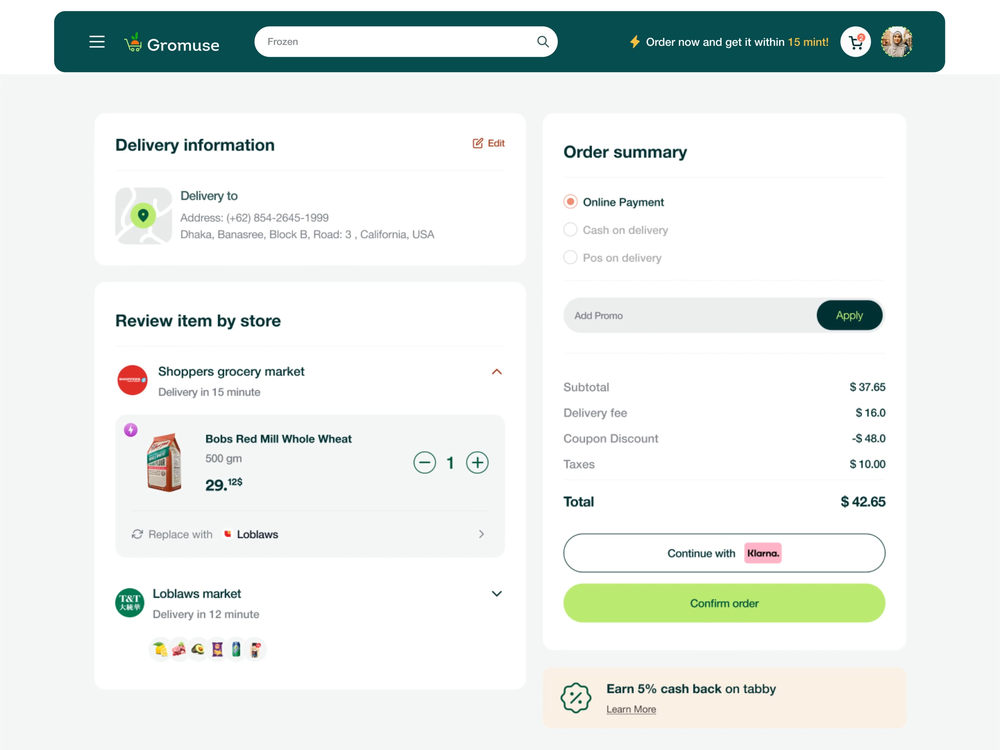

# Two-Column Grocery Checkout Page

**Discipline:** web ·  · **Design style:** Minimalist
**Tags:** ecommerce, checkout, cards, teal, lime, order-summary, forms

## What it is
A checkout screen with a teal rounded header, a left column of cards for delivery information and items grouped by store, and a right column with payment options, promo field, itemized totals, an outlined Klarna button and a lime Confirm order button.

## What it means
Soft white cards on pale gray keep a dense task calm and ordered, and the lime CTA marks the final step.

## Techniques
- Two-column split with tasks left and summary right
- Cards grouped by vendor with collapsible sections
- Right-aligned totals with a bold final line
- Promo field with an attached dark Apply button
- Muted unselected radio options to focus the selected one

## Best for
- Checkout and payment flows
- Order summary and review screens
- Multi-vendor carts

## Vocabulary
- **Order summary** — A panel listing costs, fees and total.
- **Grouped cart** — Cart items organized under their seller.
- **Primary action pill** — A full-width rounded button for the final step.
