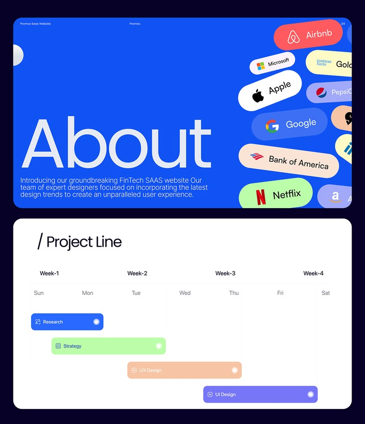

# Cobalt About Slide and Gantt Project Line

**Discipline:** web ·  · **Design style:** Dark & Neon
**Tags:** about, cobalt, brand-pills, timeline, gantt, navy, colour-bars

## What it is
Two stacked panels on navy: a cobalt panel with a huge light 'About' and a description, next to tilted client-logo pills; and a white 'Project Line' Gantt chart with coloured bars for research, strategy, UX design and UI design across four weeks.

## What it means
Tilted logo pills add energy and social proof, and the coloured Gantt makes the schedule instantly readable.

## Techniques
- Tilted pills of client logos cropped at the edge
- Giant lightweight word as the title
- Coloured horizontal bars for phases across a week grid
- Panels stacked on a dark base
- Blue as the primary, pastels for phases

## Best for
- Agency and SaaS case studies
- Project timeline slides
- Client credibility sections

## Vocabulary
- **Logo pill** — A rounded label containing a client's logo.
- **Gantt chart** — A timeline of horizontal bars showing task durations.
- **Phase bar** — A coloured bar representing one project stage.
