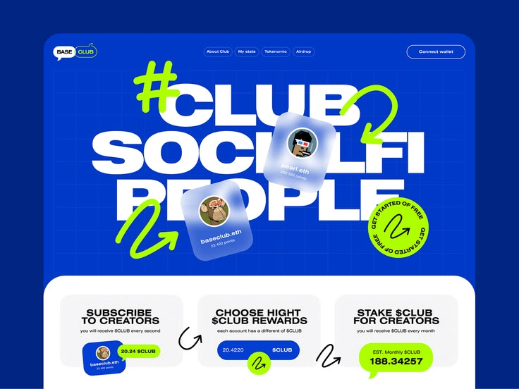

# Cobalt and Lime Web3 Club Hero

**Discipline:** web · **Design type:** Landing page hero
**Tags:** cobalt, lime, web3, giant-type, scribbles, glass-cards, stickers

## What it is
A cobalt-blue landing hero with gigantic white caps '#CLUB SOCIALFI PEOPLE', lime hand-drawn arrows and squiggles, two frosted glass profile cards, a rotating circular sticker, and three white step cards below.

## What it means
Extra-large type with hand-drawn lime marks feels loud, youthful and crypto-native. Glass profile cards add polish.

## Techniques
- Huge stacked uppercase heading that fills the width
- Hand-drawn lime scribbles and arrows over the type
- Circular text badge as a call-to-action sticker
- Frosted avatar cards overlapping the heading
- White rounded panel with three numbered steps

## Best for
- Web3, social and community products
- Bold youth brands
- Landing pages with playful energy

## Vocabulary
- **Scribble accent** — Hand-drawn lines and arrows layered over a layout.
- **Circular text badge** — A round sticker with text set around its edge.
- **Overlap headline** — Cards or shapes placed partly over large type.
