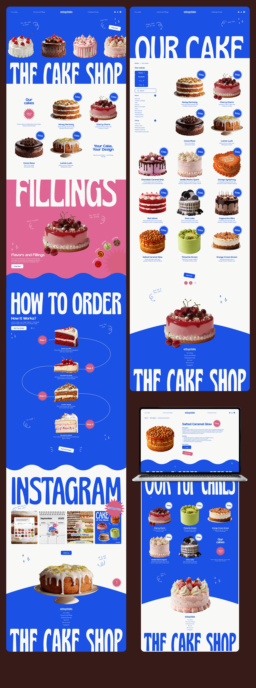

# Bakery storefront in cobalt with wavy dividers and condensed type

**Discipline:** web · **Design type:** E-commerce storefront
**Tags:** e-commerce, bakery, cobalt, wave-divider, condensed-type, pink-section, product-photography, laptop-mockup

## What it is
A long multi-view website: a cobalt hero with cake photos and a huge condensed 'THE CAKE SHOP', white product grids with price badges, a pink 'Fillings' band, a curved how-to-order path with numbered steps, an Instagram strip, and a laptop showing a product page. Sections are separated by wavy edges.

## What it means
Joyful and confectionery-like; the wavy edges feel like icing and the bold blue makes each cake glow.

## Techniques
- Cut section boundaries with wavy lines to echo the product (icing) and keep a long page flowing.
- Set section titles in huge tall condensed type cropped by the frame for drama.
- Put price in small round badges on the corner of each product photo.
- Break the blue with one pink section for rhythm.
- Draw a looping thin line between numbered steps to make a process feel like a journey.

## Best for
- Bakeries, cafés and dessert brands
- Playful e-commerce
- Sites with step-by-step ordering flows

## Vocabulary
- **Wavy divider** — A curved edge separating two colour sections.
- **Condensed display** — A tall narrow typeface used at huge size.
- **Price badge** — A small round label overlapping a product image.
- **Process path** — A curved line linking numbered steps.
