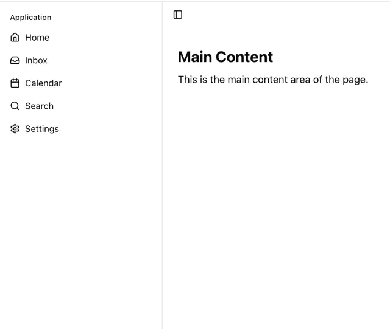

# Bare app shell: left sidebar with icon-and-label nav (Home, Inbox, Calendar, Search, Settings), a collapse toggle and a main content area

**Discipline:** web ·  · **Design style:** Minimalist
**Tags:** component, sidebar, layout, white, line-icons, app-shell, minimal, navigation

## What it is
A white layout with an 'Application' label and five thin-line icon items in a left column separated by a hairline, a small panel-toggle icon at the top of the main area and a bold 'Main Content' heading with one line of text.

## What it means
Neutral and functional; nothing but structure so any content can be dropped in.

## Techniques
- Pair line icons with labels in a vertical list.
- Separate sidebar from content with a hairline.
- Add a collapse toggle.
- Keep it monochrome.

## Best for
- Dashboard and app shell templates
- Sidebar navigation patterns
- Minimal admin layouts

## Vocabulary
- **App shell** — The persistent frame of navigation around content.
- **Sidebar nav** — A vertical list of destinations.
- **Collapse toggle** — A button that hides or shows the sidebar.
- **Line icon** — An icon drawn with thin strokes.
