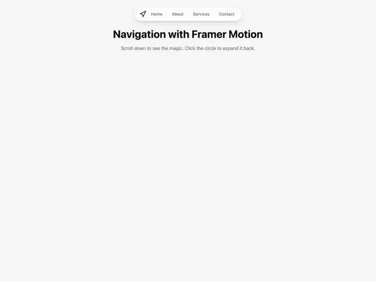

# Grey page with a small white pill nav (logo, Home, About, Services, Contact) above 'Navigation with Framer Motion' and a scroll instruction

**Discipline:** web ·  · **Design style:** Minimalist
**Tags:** component, navigation, pill, motion, white, grey, scroll, minimal

## What it is
A pale grey page with a floating white pill at the top centre holding an arrow logo and four grey links, a bold black heading 'Navigation with Framer Motion' and a grey line explaining that the nav collapses on scroll and expands on click.

## What it means
Light and playful; a nav that shrinks to a circle stays out of the way.

## Techniques
- Float a pill nav at the top.
- Collapse it into a circle on scroll.
- Expand it on click.
- Keep type minimal.

## Best for
- Floating navigation components
- Scroll-reactive UI
- Minimal landing pages

## Vocabulary
- **Collapsing nav** — A navigation that shrinks while scrolling.
- **Floating pill** — A rounded bar hovering above the page.
- **Scroll-triggered motion** — Animation driven by scroll position.
- **Icon-only state** — The collapsed version showing just an icon.
