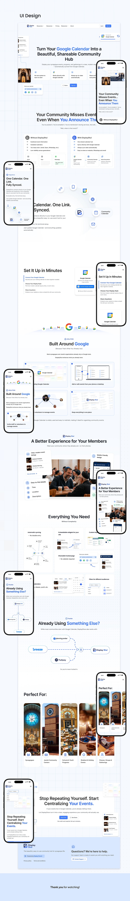

# Very long landing page for a calendar-sharing tool with paired desktop and mobile screens

**Discipline:** web · **Design type:** SaaS landing page
**Tags:** long-scroll, saas, white, blue, desktop-mobile, integration, comparison, case-study

## What it is
A tall board of a white landing page with blue accents: hero, problem section, comparison of two approaches, setup steps, Google integration diagrams, member experience with a photo, feature grid, competitor comparison and audience photos, ending with a call to action. Phone versions are staggered to the side.

## What it means
Organised and thorough; the long flow answers each objection in order.

## Techniques
- Structure the page as a sequence of objections: problem, solution, setup, integration, proof, audience, action.
- Use side-by-side comparison panels.
- Show diagrams of integrations with logos linked by dashed lines.
- Repeat the same layout on mobile next to desktop.

## Best for
- Utility SaaS and community tools
- Products built on top of a familiar platform
- Complete website case studies

## Vocabulary
- **Objection ladder** — Ordering sections to answer visitor doubts in turn.
- **Comparison panel** — A split block contrasting two approaches.
- **Integration diagram** — A picture linking a product to the tools it works with.
- **Long scroll** — A single-page layout with many stacked sections.
