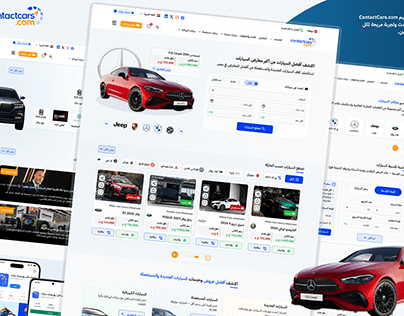

# ContactCars Arabic car marketplace: tilted collage of long pages with a red Mercedes

**Discipline:** web · **Design type:** Project cover · **Design style:** Corporate & Clean-Tech
**Tags:** automotive, marketplace, arabic, rtl, collage, blue

## What it is
A light-blue cover with several long Arabic website pages tilted and overlapping: a hero with a red Mercedes coupé and a search form, brand logo rows, listing cards of cars with prices, and a mobile app screenshot, with the ContactCars logo in the corner.

## What it means
Busy but trustworthy; the page collage shows breadth of a large marketplace at a glance.

## Techniques
- Tilt and overlap full-length pages into a collage.
- Repeat a hero car cut-out across pages.
- Include brand logo rows as a navigation device.

## Best for
- Automotive marketplaces
- Large website case studies
- Arabic web projects

## Vocabulary
- **Page collage** — Several full screens arranged overlapping.
- **Listing card** — A card showing one item for sale.
