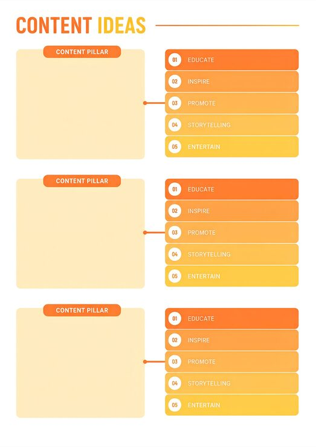

# 'Content Ideas' planner with three repeated content-pillar blocks and orange gradient numbered task lists

**Discipline:** web · **Design type:** UX documentation · **Design style:** Corporate & Clean-Tech
**Tags:** content-planning, planner, orange, gradient, numbered-list, template

## What it is
A white planning template with a bold 'CONTENT IDEAS' title and underline, repeated three times: a pale yellow blank content-pillar card linked by a short connector line to an orange-gradient numbered list (01 Educate, 02 Inspire, 03 Promote, 04 Storytelling, 05 Entertain).

## What it means
Practical and repeatable; the same five-item framework applied three times turns strategy into a fill-in-the-blank planning tool.

## Techniques
- Repeat one framework template multiple times for different topics.
- Gradient-shade a numbered list from dark to light for visual rhythm.
- Leave a blank card for the user's own notes.

## Best for
- Content marketing planning
- Social media strategy templates
- Editorial calendar tools

## Vocabulary
- **Content pillar** — A core theme around which content is organised.
- **Fill-in template** — A layout with intentionally blank space for user input.
