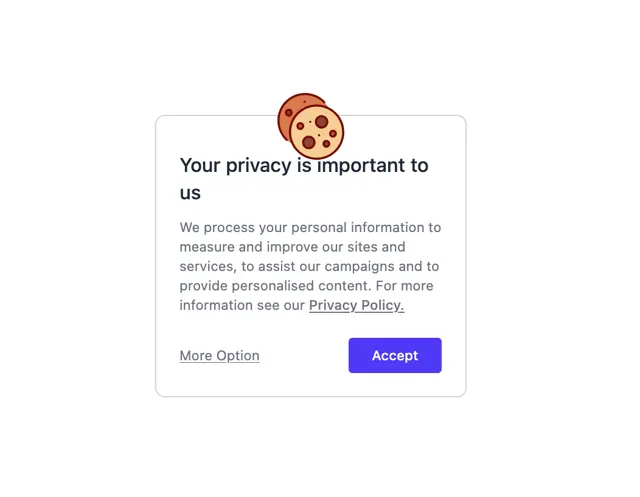

# Cookie notice card with a cookie illustration on the corner, heading, paragraph, underlined More Option link and a violet Accept button

**Discipline:** web · **Design type:** UI components
**Tags:** component, cookie-banner, consent, white, violet, illustration, card, privacy

## What it is
A white rounded bordered card with two illustrated chocolate-chip cookies overlapping its top edge, a bold heading 'Your privacy is important to us', a grey paragraph with an underlined Privacy Policy link, an underlined More Option link at the left and a violet Accept button at the right.

## What it means
Friendly and clear; a cookie illustration softens a legal notice.

## Techniques
- Overlap an illustration on the card edge.
- Use one violet primary button.
- Style the secondary action as an underlined link.
- Keep text short.

## Best for
- Cookie and privacy banners
- Consent components
- Friendly legal notices

## Vocabulary
- **Consent banner** — A notice asking permission for cookies.
- **Edge illustration** — An image overlapping a card's border.
- **Text-link secondary** — A low-emphasis action styled as a link.
- **Primary accept** — The main colour button to agree.
