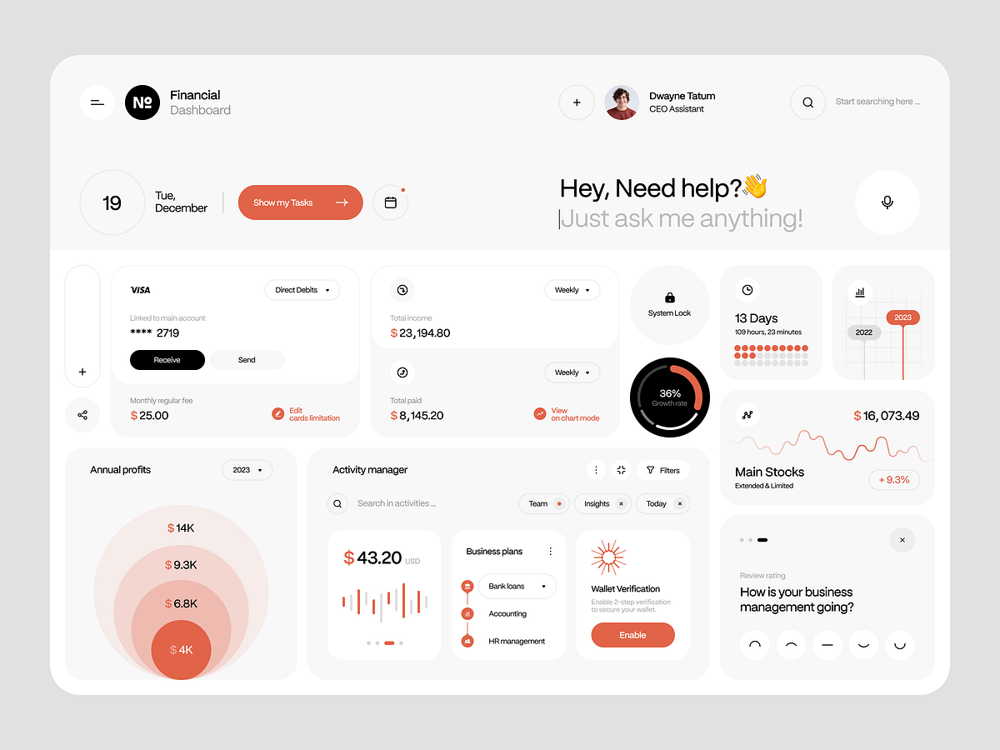

# Coral Financial Dashboard with Ask Prompt

**Discipline:** web ·  · **Design style:** Geometric & Bauhaus
**Tags:** dashboard, coral, white, bento, concentric-circles, prompt, finance

## What it is
A rounded pale dashboard with a header of logo, user and search, a date circle and a coral Show my Tasks button beside a large 'Hey, Need help? Just ask me anything!' prompt with a mic button, and a bento of cards: a Visa card, totals, a system lock, a growth ring, a stocks line, concentric circles of annual profit, an activity manager, a wallet verification card and a rating question.

## What it means
Coral on cream and white is warm and friendly for finance, and concentric circles make profit brackets visual.

## Techniques
- Coral as the single accent on cream
- Concentric circles as a profit chart
- Big conversational prompt in the header
- Mixed bento of small cards and rings
- Emoji rating buttons drawn as simple faces

## Best for
- Financial and business dashboards
- AI assistant prompts in dashboards
- Warm single-accent UI

## Vocabulary
- **Concentric chart** — Nested circles sized by value.
- **Prompt header** — A large question inviting the user to ask the assistant.
- **Bento dashboard** — A dashboard built from tiles of different sizes.
