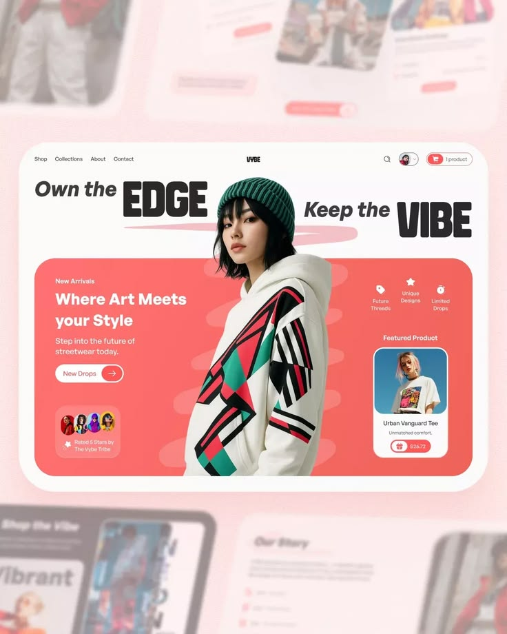

# Coral Streetwear Hero with Model over Headline

**Discipline:** web ·  · **Design style:** Glassmorphism
**Tags:** streetwear, coral, hero, cut-out, display-type, cards, blurred-backdrop

## What it is
A rounded website card over blurred pink screens: a nav, a headline 'Own the EDGE Keep the VIBE' set around a cut-out model in a beanie and printed hoodie who overlaps the coral hero panel, with a New Drops button, rating chips, feature icons and a featured product card.

## What it means
The model breaking out of the coral panel and splitting the headline creates depth and attitude, and coral feels youthful.

## Techniques
- Cut-out model overlapping the headline and panel
- Italic script words alongside heavy display words
- Coral panel with soft blobs
- Featured product card with a price pill
- Blurred backdrop of other screens

## Best for
- Fashion and streetwear stores
- Hero sections with a cut-out figure
- Coral and white e-commerce

## Vocabulary
- **Break-out hero** — A subject overlapping the boundary of its container.
- **Display pairing** — Heavy display type paired with italic light words.
- **Featured product card** — A small card highlighting one product.
