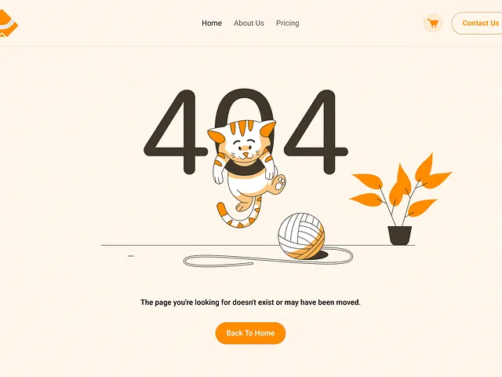

# Cream 404 with dark thin numerals, a cat hanging through the zero, an orange yarn ball and a potted plant

**Discipline:** web ·  · **Design style:** Warm & Organic
**Tags:** 404, error-page, illustration, cream, orange, line-art, cat, minimal

## What it is
A cream page with a thin nav and orange outlined Contact button, large dark line numerals '404' where an orange-and-white cat pokes through the zero, an orange ball of yarn with a trailing thread, an orange potted plant, a short line 'The page you're looking for doesn't exist or may have been moved.' and an orange Back To Home pill.

## What it means
Warm and witty; the cat playing with yarn softens the dead end.

## Techniques
- Let a character interact with the numerals.
- Use clean line art with one orange accent.
- Add a thin ground line.
- Provide one orange exit button.

## Best for
- Friendly brand error pages
- Line-art illustrations
- Cream and orange sites

## Vocabulary
- **Character in numerals** — A figure interacting with the digits of 404.
- **Line art** — Illustration drawn with outlines.
- **Yarn trail** — A thin thread line leading from a ball.
- **Ground line** — A thin horizontal line that grounds a scene.
