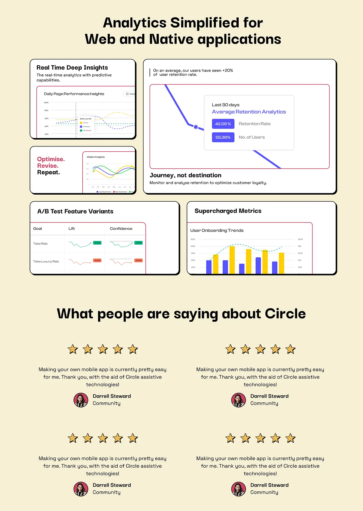

# Butter-cream analytics page: heavy black-outlined chart cards with red keylines, and a grid of five-star quotes

**Discipline:** web ·  · **Design style:** Neo-Brutalist
**Tags:** saas, analytics, cream, neo-brutalism, black-outline, red-keyline, charts, testimonials

## What it is
A butter-cream page with a centred heavy headline, five chart cards with thick black outlines and hard shadows each containing a chart panel in a thin red keyline (real-time insights, retention, A/B tests, metrics), a 'Journey, not destination' caption and a second section with a 2x2 grid of centred five-star testimonials with round avatars.

## What it means
Friendly and confident; thick outlines make data charts feel like stickers.

## Techniques
- Outline cards in thick black with hard shadow.
- Frame charts in thin red keylines.
- Cut chart cards off at the bottom.
- Centre testimonials with yellow stars.

## Best for
- Analytics and app-builder landing pages
- Neo-brutalist light pages
- Chart-led feature grids

## Vocabulary
- **Sticker card** — A card with thick outline and hard shadow.
- **Red keyline** — A thin red border around a chart.
- **Cropped chart** — A chart cut by its card edge.
- **Star row** — Five stars above a quote.
